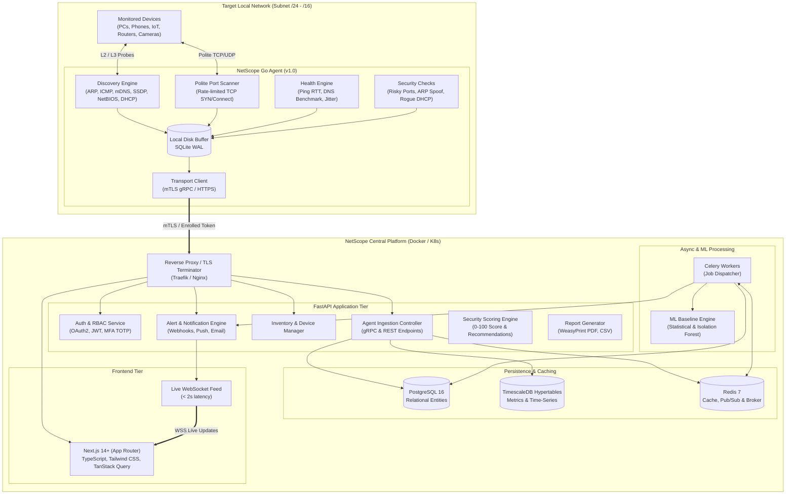
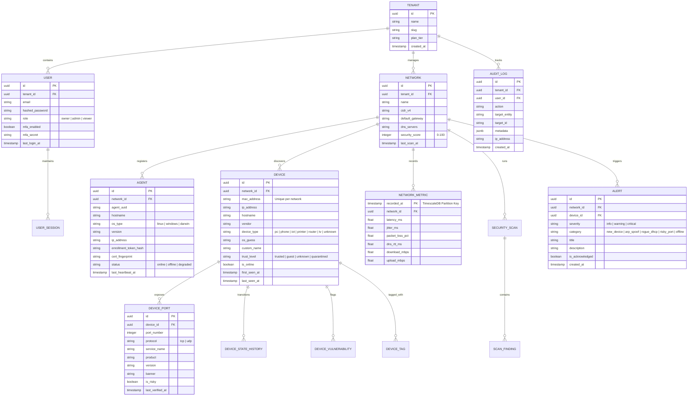

# NetScope — Deliverable 2: Architecture, Data Model (ER), Agent Protocol & OpenAPI Specification

**Project:** NetScope (Production-Grade Network Discovery, Monitoring & Security Platform)  
**Document Version:** 1.0.0  
**Status:** Architectural Specification  
**Author:** Senior Network-Security Engineer & Full-Stack Architect  

---

## 1. System Architecture Overview

NetScope uses a modern distributed architecture separating the **low-privilege edge probe (Go Agent)** from the **central analytics and management plane (FastAPI + TimescaleDB + Celery + Next.js)**.



---

## 2. Entity-Relationship Data Model (ER Diagram)

The relational and time-series schemas are engineered for high write throughput, multi-tenant isolation, and fast historical rollups.



---

## 3. Agent-to-Backend Protocol Specification

The agent communicates with the backend via a protocol that supports **both high-efficiency gRPC (over HTTP/2 with mTLS)** and a **fallback HTTPS/REST + WebSocket stream**, catering to restricted firewall environments.

### 3.1 Enrollment & Authentication Handshake

1. **Step 1 (Token Issuance):** Admin creates an agent enrollment token in the NetScope UI (single-use, TTL 1 hour).
2. **Step 2 (Enrollment Exchange):**
   - Agent boots and requests enrollment: `POST /api/v1/agents/enroll` passing `{ "token": "NETSCOPE-ENROLL-XYZ...", "hardware_uuid": "...", "hostname": "..." }`.
   - Backend validates token, creates `AGENT` record, and issues an **X.509 Agent Certificate** signed by NetScope's Internal CA (or an asymmetric JWT agent key).
3. **Step 3 (Encrypted Telemetry Channel):**
   - Agent establishes a persistent gRPC stream with client certificate authentication (`mTLS`).
   - If gRPC is blocked by an intermediate enterprise proxy, agent falls back automatically to HTTPS + `Authorization: Bearer <agent_jwt>`.

### 3.2 Protocol Buffer Definition (`proto/netscope/v1/agent.proto`)

```protobuf
syntax = "proto3";

package netscope.v1;

option go_package = "github.com/netscope/netscope/agent/pkg/pb;netscopev1";

service AgentService {
  rpc Heartbeat(HeartbeatRequest) returns (HeartbeatResponse);
  rpc StreamTelemetry(stream TelemetryBatch) returns (StreamAck);
  rpc ReportScanResults(ScanReport) returns (ReportAck);
}

message HeartbeatRequest {
  string agent_id = 1;
  int64 timestamp = 2;
  string agent_version = 3;
  AgentHealth health = 4;
}

message AgentHealth {
  float cpu_usage_pct = 1;
  float memory_usage_mb = 2;
  int32 queued_events_count = 3;
}

message HeartbeatResponse {
  bool acknowledge = 1;
  int64 next_interval_seconds = 2;
  repeated Command commands = 3; // e.g. TRIGGER_FULL_SCAN, UPDATE_RATE_LIMIT
}

message TelemetryBatch {
  string agent_id = 1;
  string network_id = 2;
  int64 batch_timestamp = 3;
  repeated DeviceDiscovered devices = 4;
  repeated NetworkMetricPoint metrics = 5;
  repeated SecurityEvent security_events = 6;
}

message DeviceDiscovered {
  string mac_address = 1;
  string ip_address = 2;
  string hostname = 3;
  string vendor = 4;
  string os_fingerprint = 5;
  string device_type_hint = 6;
  repeated DiscoveredPort open_ports = 7;
  bool is_alive = 8;
  int64 observed_at = 9;
}

message DiscoveredPort {
  int32 port = 1;
  string protocol = 2; // "tcp" | "udp"
  string service_name = 3;
  string banner = 4;
  bool is_risky = 5;
}

message NetworkMetricPoint {
  int64 recorded_at = 1;
  float latency_ms = 2;
  float jitter_ms = 3;
  float packet_loss_pct = 4;
  float dns_rtt_ms = 5;
}

message SecurityEvent {
  string event_type = 1; // "ROGUE_DHCP", "ARP_SPOOF", "RISKY_PORT"
  string source_mac = 2;
  string source_ip = 3;
  string description = 4;
  string severity = 5;
  int64 timestamp = 6;
}

message Command {
  string command_id = 1;
  string action = 2; // "SCAN_NOW", "CONFIG_CHANGE", "WAKE_ON_LAN"
  map<string, string> parameters = 3;
}

message StreamAck {
  bool success = 1;
  int32 accepted_events = 2;
}

message ScanReport {
  string scan_id = 1;
  string network_id = 2;
  int64 started_at = 3;
  int64 completed_at = 4;
  int32 total_hosts_scanned = 5;
  int32 active_hosts_found = 6;
  repeated DeviceDiscovered host_details = 7;
}

message ReportAck {
  bool success = 1;
  string message = 2;
}
```

---

## 4. OpenAPI 3.1 REST API Specification Summary

The backend exposes an OpenAPI 3.1 compliant REST API for the Next.js web application, external integrations, and automation scripts:

| Endpoint | Method | Role | Description |
|---|---|---|---|
| `/api/v1/auth/login` | POST | Public | OAuth2 password flow with JWT token issuance. |
| `/api/v1/auth/mfa/verify` | POST | Authenticated | TOTP second-factor authentication check. |
| `/api/v1/networks` | GET, POST | Viewer / Admin | List managed subnets or register a new target network. |
| `/api/v1/networks/{id}/devices` | GET | Viewer | Search and filter discovered devices (by type, status, risk). |
| `/api/v1/devices/{id}` | GET, PATCH | Viewer / Admin | View device details, update nickname, tags, and trust tier. |
| `/api/v1/devices/{id}/wol` | POST | Admin | Dispatch Wake-on-LAN command to agent on that subnet. |
| `/api/v1/networks/{id}/metrics` | GET | Viewer | Query TimescaleDB time-series metrics (latency, packet loss, DNS). |
| `/api/v1/networks/{id}/security`| GET | Viewer | Retrieve 0-100 security score and active risk advisories. |
| `/api/v1/networks/{id}/scan` | POST | Admin | Trigger on-demand rate-limited network discovery / port scan. |
| `/api/v1/reports/export` | GET | Admin / Viewer | Generate and stream PDF or CSV security and inventory reports. |
| `/api/v1/agents/enroll` | POST | Agent | Exchange enrollment token for credentials. |
| `/api/v1/agents/telemetry` | POST | Agent | HTTPS fallback ingestion endpoint for agent telemetry batches. |
| `/api/v1/ws/live` | WebSocket | Authenticated | Real-time broadcast of device changes and high-priority alerts. |

---

## 5. Security Score Calculation Methodology

The NetScope Security Score is a deterministic 0–100 index derived from four weighted pillars:

$$\text{SecurityScore} = 100 - (\Delta_{\text{Ports}} + \Delta_{\text{Protocols}} + \Delta_{\text{Integrity}} + \Delta_{\text{Hygiene}})$$

1. **Port Exposure Penalty ($\Delta_{\text{Ports}}$, max 40 pts):**
   - Telnet (port 23): $-15$ pts per device.
   - Unencrypted FTP (port 21): $-10$ pts per device.
   - Exposed SMBv1 (port 445): $-15$ pts per device.
   - Exposed RDP (port 3389): $-10$ pts per device.
   - Open UPnP WAN gateway (port 1900/5000): $-15$ pts.
2. **Protocol & Infrastructure Integrity ($\Delta_{\text{Integrity}}$, max 30 pts):**
   - Active ARP spoofing detected: $-30$ pts (immediate Critical alert).
   - Rogue DHCP server detected: $-20$ pts.
   - DNS hijacking or unencrypted upstream failure: $-15$ pts.
3. **Device Hygiene ($\Delta_{\text{Hygiene}}$, max 20 pts):**
   - Unidentified/Unknown devices on network: $-2$ pts each.
   - Devices running outdated service banners: $-5$ pts.
4. **Credential Verification ($\Delta_{\text{Protocols}}$, max 10 pts):**
   - Any confirmed default credential (e.g. `admin/admin` on camera/router): $-20$ pts (clamped to floor 0).

