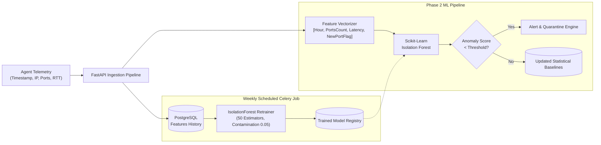
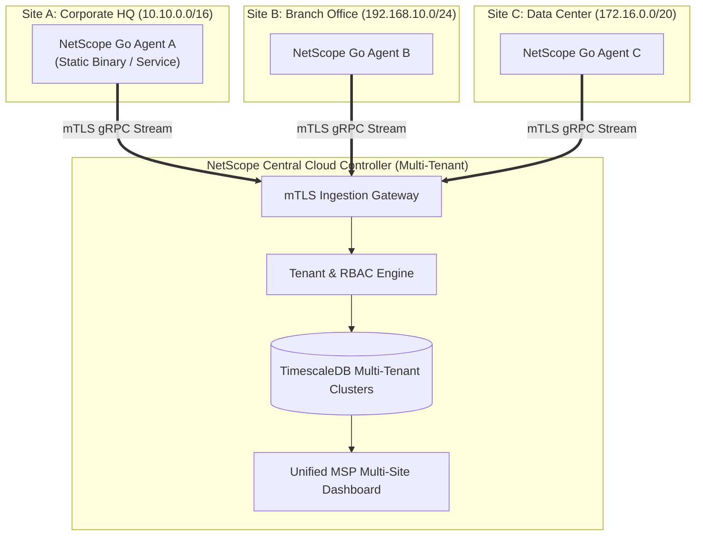

# NetScope — Phase 2 Architecture & Roadmap Specification

**Document Version:** 2.0.0  
**Status:** Approved for Implementation  
**Focus:** Machine Learning Anomaly Detection, Multi-Site Central Cloud Plane, Hardware Router Integrations & SNMP.

---

## 1. Machine Learning Anomaly Detection Architecture

### 1.1 Objective
Move beyond static signature matching to detect stealthy intrusions, lateral movement, compromised IoT devices, and beaconing command-and-control (C2) activity using per-device statistical and unsupervised machine learning baselines.

### 1.2 Feature Engineering
For every device, NetScope tracks:
- **Temporal Rhythm:** Probability distribution of activity across 24 hours (e.g., IoT thermostat active 24/7 vs. office workstation active 08:00–18:00).
- **Service Footprint:** Jaccard similarity of open ports against the historical baseline. A sudden listening port (e.g. `4444` reverse shell or `23` Telnet) triggers an immediate high-severity anomaly flag.
- **RTT / Jitter Distribution:** Deviations > 3.0 standard deviations from the rolling mean indicate congestion or man-in-the-middle ARP spoofing.

---

## 2. Multi-Site & MSP Central Cloud Dashboard

For Managed Service Providers (MSPs) and multi-branch enterprises:

### Key Capabilities:
- **Global Inventory Search:** Find any device across all company sites by MAC, IP, or hostname in < 100ms.
- **Cross-Site Vulnerability Rollup:** Executive reporting comparing security scores between branches.
- **Role-Based Tenant Isolation:** MSP clients only access their own network data; MSP super-admins view cross-tenant fleet metrics.

---

## 3. Router Integrations (Automated Isolation & Quarantine)

NetScope integrates with network infrastructure to automate threat mitigation:

| Platform | Protocol / API | Capabilities |
|---|---|---|
| **Ubiquiti UniFi** | UniFi Controller REST API | - Auto-assign compromised device to Quarantined VLAN - Block client MAC via Wi-Fi controller - Read wireless signal strength (RSSI) & AP association |
| **OpenWrt** | `ubus` / LuCI RPC over HTTPS | - Inject `iptables` / `nftables` drop rules for quarantined IP - Read live DHCP lease table - Disable switch port via `swconfig` |
| **MikroTik** | RouterOS REST API / WinBox | - Append hostile host to `/ip firewall address-list` - Isolate client from default bridge |

---

## 4. SNMP v2c/v3 Switch Port Mapping

To identify the exact physical switch port where an unauthorized device is plugged in:
1. **Bridge MIB Polling (`dot1dTpFdbTable` - 1.3.6.1.2.1.17.4.3):** Resolves MAC address to bridge port number.
2. **Interface MIB Polling (`ifTable` - 1.3.6.1.2.1.2):** Maps bridge port number to physical interface label (e.g. `GigabitEthernet1/0/14`).
3. **LLDP / CDP Polling:** Auto-discovers interconnects between switches, routers, and access points.

